<div align="center">


<a href="https://github.com/CheginiSoroush/flash-panel"></a>

[](https://github.com/CheginiSoroush/flash-panel/releases)
[](https://github.com/CheginiSoroush/flash-panel/actions)
[](https://github.com/CheginiSoroush/flash-panel/actions)
[](https://github.com/CheginiSoroush/flash-panel/blob/main/scripts/build.js)

[](#-how-a-request-flows)
[](LICENSE)
[](#)
[](https://github.com/CheginiSoroush/flash-panel)

[🇮🇷 فارسی](README_fa.md) · [🪄 Flash Wizard](https://github.com/CheginiSoroush/flash-wizard) · [📖 Documentation](#-documentation) · [⬆ Install](#-deploy)

</div>

<div align="center">


### ⚡ At a glance

| | | | |
|:---:|:---:|:---:|:---:|
| **$0** forever | **0** servers | **497** unit tests | **139 KB** gzipped |
| **3** config cores | **205** live configs | **6/6** field-test layers | **100%** serverless |
| **ETag** instant 304s | **gzip** sub responses | **3-mirror** self-update | **24/7** self-tuning |


</div>

## 🌀 How a request flows

<div align="center">



</div>

Every connection is **token-gated**, measured, and remembered — the panel learns from its own traffic and re-tunes itself. No fork does this.

---

## ✨ Why Flash?

Most forks change the **brand**. Flash Panel rebuilt the **engine** — then took it into the field and made it prove every claim:

<details open>
<summary><b>🔥 Protocol core — rewritten from scratch</b></summary>

| Fix | Impact |
|-----|--------|
| Race condition on socket writer | Connections dying mid-handshake → eliminated |
| SHA-224 recomputed **every connection** | Now cached — Trojan auth costs ~zero |
| Copy-heavy VLESS parsing (10× `slice()`) | Zero-copy views — CPU per connection dropped |
| Writer lock acquired per-chunk | Cached per-socket — sustained throughput |
| KV read on **every request** | Isolate-level cache + 5s TTL + anti-stampede |
| Subscription regeneration on every fetch | ETag/304 — configs served instantly when unchanged |
| Pretty-printed JSON configs (~20MB) | Minified — **94% smaller subscriptions** |

</details>

<details open>
<summary><b>🛰️ Edge Intelligence — the panel that watches itself</b> <i>(v0.8.4 / v0.8.5)</i></summary>

Most panels fly blind. Flash Panel turned Cloudflare's own per-request metadata into a **closed quality-control loop**:

- 🛰️ **`request.cf` edge telemetry** — every real WS handshake (after the token gate) and 25% of subscription fetches silently record `colo`, `clientTcpRtt`, `ASN + organization`, `tlsVersion`, `httpProtocol`. No extra pings, **no IPs stored** — your own clients become the probe fleet
- 📊 **Per-connection byte counters** — WS up/down bytes + duration per connection, zero cost on the hot path (WeakMap, GC'd on close) → *"which ISP moves how much traffic through which datacenter"*
- 💰 **Free-plan budget engineering** — in-isolate buffering → batched flush (12 samples / 15s), 2,000 samples/day cap, 40 flushes per isolate, 48h pruning, top-12 colos + top-24 ASNs → far under 1,000 KV writes/day
- 🎯 **Closed-loop auto-tuning** — a daily RTT baseline (EMA 85/15); when today's average jumps (≥ +40 ms **and** ≥ 1.5×, ≥ 8 samples) the **ProxyIP / CleanIP tuners fire automatically** and Telegram receives the worst-ASN list (6h tune cooldown / 12h alert cooldown)
- 🧭 **Visible everywhere** — `/edge` bot command, a daily-digest line, and an authenticated panel endpoint with human-readable byte formatting (B → TB)
- 🔬 **Reverse-engineered transports** — HTTPUpgrade is *free* server-side (proven: `101 Switching Protocols`) but deprecated/dead in modern Xray clients → 35 dead profiles were built, tested and **killed before ever reaching production**; the real future path is XHTTP + Durable Objects (v0.9.0 candidate)
- 🩺 **Incident forensics** — the *"zero-byte connection"* signature (101 answered, no bytes exchanged) cleanly separates platform egress flakiness from code regressions

</details>

<details>
<summary><b>🛡️ Security — not an afterthought</b></summary>

- 🔐 **Login rate-limiting** + constant-time credential comparison
- 🤖 **Telegram webhook secret validation** — forged updates rejected
- 🔒 Login page / settings / subscriptions fully separated
- ⚡ `workers.dev` route **auto-disabled** — scanner-proof by design (auto-guard re-checks every 30 minutes, alerts via Telegram)
- 🎫 **Token-gated WebSocket paths** — WS routes are derived from the secret path (deterministic 96-bit token); active probes get a realistic camouflage fallback instead of a `101` handshake that screams "this is a proxy worker"
- 🎭 **uTLS fingerprint rotation** — generated configs rotate fingerprints deterministically (60% Chrome / 20% iOS / 20% Firefox) so all clients never share one JA3 class that a single DPI rule could kill
- 🕶️ **Camouflage fallback** — every non-panel path transparently proxies to a real high-traffic website (path/method preserved) — casual scanners see an ordinary site

</details>

<details>
<summary><b>🧯 Resilience — degrades gracefully, never silently</b> <i>(v0.8.6 → v0.8.10)</i></summary>

Free plans have hard walls — 1,000 KV writes/day, filtered mirrors, rate limits. Flash Panel bends instead of breaking:

- 📉 **KV write-diet** — settings reads cached at isolate level (5s TTL + anti-stampede), telemetry batched (12 samples / 15s, 2,000/day cap) — the whole panel now runs on ~150–250 KV writes/day
- 🪫 **Quota-dead degrade (v0.8.9)** — when the daily KV quota dries up: bootstrap/migration writes become best-effort, reads are absorbed by isolate caches, the service stays up and self-heals after the UTC reset — **no crash, no data loss, no silent behavior**
- 🤖 **Unkillable bot buttons (v0.8.10)** — under a dead KV quota, Telegram prompts still open (with an "offline — reply to this message" hint), unknown callbacks get explicit answers, crashes report loudly — **12 dedicated tests** pin every path
- 🧾 **Honest usage (v0.8.7)** — usage charts never fake zeros again: sampling failures are visible, quota warnings have hourly cooldowns, `/usage` and its button share one renderer
- 🛰️ **Honest errors everywhere** — update-panel failures name the real cause (GitHub 403 / token permission / quota), webhook handlers never swallow exceptions into fake 200s

</details>

<details>
<summary><b>⚙️ Automation — the panel runs itself</b></summary>

Set the cron trigger once (`'0 * * * *'` in `wrangler.jsonc`) and the panel takes care of the rest:

- ⏰ **Auto-expiry for subscription users** — give any user an expiry date; their links stop the second it passes (self-enforcing at resolve time, no cron needed), the hourly sweep marks them revoked in the panel, and you get a Telegram notification
- 📋 **Daily digest** — one message per day: usage vs quota, active/expired/revoked counts, next expirations, top users, an edge-telemetry line (also on demand: `/digest`)
- 🔴 **Usage alert** — a one-time warning when total requests cross 80% of the daily Free quota
- 📊 **Usage sampling without visits** — the 31-day chart stays complete even on days nobody opens the panel
- ⚡ **Auto best ProxyIP** — one click tests every configured Proxy IP (batched, 2 attempts each) and redeploys the worker with the fastest healthy one as primary
- 🧹 **workers.dev guard** — if anyone re-enables `*.workers.dev` previews, the next tick closes them again before scanners can latch on

</details>

<details>
<summary><b>⚡ Performance — less CPU, less data</b></summary>

- 🧠 **Per-ETag subscription body cache** — generated configs (Xray JSON / Clash YAML / raw base64) are memoized inside the isolate keyed by their ETag, which already covers version + all settings + client + user. Repeat fetches within the 5-minute TTL skip config generation *entirely* — no DNS resolve, no JSON building, no btoa — near-zero CPU for the most-hit endpoint
- 🗜️ **gzip subscription responses** — bodies ≥ 1 KB are compressed with the native `CompressionStream` when the client sends `Accept-Encoding: gzip` (v2rayNG, Hiddify, Streisand and friends all do). Config JSON/YAML compresses ~70–80% — directly less mobile data burned on every update, and `Vary: Accept-Encoding` keeps variants from mixing
- 🖼️ **QR memoization** — the QR PNG encoder (RGBA loop + deflate) runs once per unique config link; the panel's QR modal re-opens now cost zero CPU. Browser cache headers (`max-age=3600`) prevent re-fetching altogether
- 🔧 **Micro-hygiene** — module-level `TextEncoder` for ETag hashing, header snapshots stored with the cache instead of per-request rebuilds

All of it is memory-bounded (LRU + size caps) and covered by unit tests — **497/497 green across 34 files**.

</details>

<details>
<summary><b>🧭 Anti-403 — configs that just connect</b></summary>

A `403` means your connect address (usually `workers.dev`) is blocked by your ISP. Flash Panel now fights back automatically:

- 🧪 **Clean IP optimizer** (`/clean-ip` page) — one click **Auto-optimize**: discovers fresh candidate IPs from public aggregators, probes every configured Clean IP + candidate (TCP edge probe, 2 attempts), reorders the list **healthy-first, fastest on top**, adds up to 5 newly found healthy IPs and redeploys — the whole loop without touching the settings form
- 🥇 **Clean IPs First (Anti-403)** — when enabled, Clean IPs become the *first* connect address in every generated config instead of the (often-blocked) worker domain
- 🩺 **Per-endpoint health & latency** — every row shows success rate and TCP latency, so dead endpoints are visible at a glance
- 📰 **Smart subscription headers** — `profile-update-interval`, `profile-web-page-url` and `subscription-userinfo` (auto expiry countdown for subscription users) are served to modern clients (Hiddify, v2rayNG, Streisand)

</details>

<details>
<summary><b>✈️ Telegram — first-class through the tunnel</b></summary>

A classic MTProto proxy can't run on Cloudflare Workers (Telegram apps connect to MTProto proxies over raw TCP — Workers only accept HTTP/WebSocket). Your subscription already tunnels Telegram the reliable way:

- 🧲 **Telegram Routing (Always Tunnel)** — on by default: explicit rules in every generated config (Xray / sing-box / Clash) route Telegram's official domains **and all 13 datacenter CIDRs** (IPv4 + IPv6) through the tunnel — *before* any block/bypass rule, so even `bypass Iran/China` profiles can never send Telegram direct
- 🧾 **Geo-file independent** — rules are plain domain/IP lists baked into the config: no geosite download needed, works on old client geo databases
- 🤖 **`/tg` bot command** — step-by-step Telegram setup guide (v2rayNG / Hiddify / Streisand) straight from the bot
- 📞 **Honest voice-call note** — normal configs carry messages, media and files (TCP); for voice/video calls use the **Warp** subscription type (UDP)

</details>

<details>
<summary><b>🤖 Telegram Bot — full panel control from your pocket</b></summary>

The panel URL is often filtered. Your Telegram isn't.

```text
/config    — get configs + QR codes
/status    — live panel overview
/edge      — edge telemetry: RTT/bytes per datacenter & ASN
/tg        — Telegram setup guide
/users     — per-user stats + expiry countdowns
/digest    — daily summary on demand
/settings  — 18 editable fields (DNS, protocols, clean IPs, routing rules...)
/restart   — instant cache reset
```

</details>

<details>
<summary><b>🔄 Panel self-update — built to survive GitHub 403s</b></summary>

The one-click **Update panel** button fetches the latest `worker.js` and redeploys it with your settings intact. Server-side downloads of GitHub release assets used to fail from shared Cloudflare edge IPs (`403`/`429` rate limits) — the update engine now:

- **3 mirrors with automatic fallback** — GitHub Releases → GitHub Pages mirror (`site/download/worker.js`, republished on every release) → jsDelivr CDN
- **Retries with backoff** on `403`/`429`/`5xx`/timeouts; `404` short-circuits to the next mirror
- **Content validation** — an HTML error page or truncated body is never deployed (length + `export default` checks)
- **10-minute edge cache + request coalescing** — repeated clicks cost zero extra fetches
- **Honest errors** — the panel toast shows the real reason (GitHub 403 / token permission / quota) instead of a blind *"please try again"*
- **Dual-path version check (v0.8.8)** — browser mirrors first, then a **server-side edge fallback** that bypasses ISP filtering: the Update button activates even where `raw.githubusercontent.com` / jsDelivr are blocked (10-minute isolate cache, zero KV writes)

> 💡 If your panel is older than **v0.7.1** and the update button fails, retry in a few minutes (the 403 is transient) or upload `worker.js` manually via the Cloudflare dashboard / Flash Wizard — after that, every future update uses the mirror engine.

</details>

<details>
<summary><b>🧪 Engineering — built like production software</b></summary>

- **497 unit tests** across 34 files — protocol parsers, settings validators, KV migrations, sub-users, telemetry, tuners, guards, update-check, telegram resilience, KV-degrade harnesses
- **CI on every push** — typecheck → tests → build → **bundle gate** (gzip ≤ 150 KB, ~4.5% of the Workers free-plan limit)
- **Automated releases** — tag → build → publish → Pages mirror
- **Self-update from panel** — zero-downtime upgrades via the 3-mirror engine

</details>

---

<div align="center">


### 📊 Benchmark — vs "optimized" forks

*Same settings, same IPs, same ports — side by side*

| | Flash Panel | Other fork |
|---|:---:|:---:|
| Working configs | **72 / 85** ✅ | 59 / 85 |
| Lowest ping | **Flash** ✅ | — |

**+22% more working configs** — measured, not claimed.


### ⚔️ The gap — Flash Panel vs typical VPS panels

| | ⚡ **Flash Panel** | Typical VPS panels |
|---|:---:|:---:|
| Runs on | **free Cloudflare Workers account** | a VPS you rent, patch & babysit |
| Monthly cost | **$0** — 100k requests/day included | $3–15, every month |
| Protocol core | **rebuilt from scratch**, strict TypeScript | inherited code, patch on patch |
| Automated tests | **497 passing**, CI-gated | usually none |
| Self-update under censorship | **3 mirrors + edge fallback** | one GitHub URL |
| KV-quota death | **degrades & self-heals** | crashes or hides it |
| Telemetry & self-tuning | **closed-loop, per-ASN** | none — flies blind |
| Exposure | **hidden behind Cloudflare's edge** | your VPS IP is the front door |

### 🧾 Field receipts — measured against the live panel

| Receipt | Result |
|---|:---:|
| Real xray 26.x via domain + SNI | **HTTP 200 · ~723 KB/s** · exit IP verified |
| Real xray 26.x via Clean IP | **HTTP 200 · ~416 KB/s** · full tunnel |
| Live subscription audit | **205 configs · 17 addresses**, all client-parseable |
| Release mirrors | **3/3 byte-identical** (sha256-compared) |
| Field-test layers | **6/6 green** — code → live panel |

**Same protocol. Different league.**


</div>

---

## 🚀 Deploy

### 🪄 Flash Wizard — 60 seconds, no CLI

**[→ Get Flash Wizard — deploy it yourself](https://github.com/CheginiSoroush/flash-wizard)**

> ⚠️ **Never publish your live panel URL.** Scanners continuously probe `*.workers.dev` and file automated abuse reports — accounts have been suspended this way. A $3/year domain on a Cloudflare zone keeps you off the radar. Keep the wizard's workers.dev name private (it is only used once, during setup).

### Manual

```bash
npm install
cp wrangler.jsonc.example wrangler.jsonc
# edit wrangler.jsonc: account_id + KV namespace id, then build & deploy:
npm run check && npm run test && npm run build
npx wrangler deploy
```

Credentials (`EMBEDED_SETTINGS`) are injected at deploy time by **Flash Wizard**. For a fully manual deploy, prepend this block to `dist/worker.js` (replace the values with yours):

```js
Object.assign(globalThis, { EMBEDED_SETTINGS: {
    accID: "<account id>", accEmail: "<account email>", apiToken: "<scoped api token>",
    vlUUID: "<uuid>", trPass: "<trojan password>", securePath: "<secret path>",
    proxyIpMode: "proxyip", proxyIPs: [], prefixes: [],
    mainDomain: "<your domain>", fallback: "www.speedtest.net", dohUrl: ""
}});
```

> The wizard handles all of this automatically — manual mode is for CI pipelines and edge cases.

---

## 📈 Stats

<div align="center">

<table>
<tr>
<td width="50%">

<picture>
  <source media="(prefers-color-scheme: dark)" srcset="https://github-readme-stats.vercel.app/api?username=CheginiSoroush&show_icons=true&hide_border=true&bg_color=00000000&title_color=f59e0b&icon_color=fb7185&text_color=e6edf3" />
  
</picture>

</td>
<td width="50%">

<picture>
  <source media="(prefers-color-scheme: dark)" srcset="https://streak-stats.demolab.com?user=CheginiSoroush&hide_border=true&background=00000000&stroke=f59e0b&ring=f97316&fire=fbbf24&currStreakNum=e6edf3&sideNums=e6edf3&currStreakLabel=f59e0b&sideLabels=a8a29e&dates=9ca3af" />
  
</picture>

</td>
</tr>
</table>

<picture>
  <source media="(prefers-color-scheme: dark)" srcset="https://github-readme-stats.vercel.app/api/top-langs/?username=CheginiSoroush&layout=compact&hide_border=true&bg_color=00000000&title_color=f59e0b&text_color=e6edf3&langs_count=8" />
  
</picture>

### 🐍 The endless contribution

<picture>
  <source media="(prefers-color-scheme: dark)" srcset="https://raw.githubusercontent.com/CheginiSoroush/flash-panel/output/github-contribution-grid-snake-dark.svg" />
  
</picture>

</div>

### 🧰 Built with

<div align="center">


<details>
<summary><b>⭐ Star history</b></summary>

<picture>
  <source media="(prefers-color-scheme: dark)" srcset="https://api.star-history.com/svg?repos=CheginiSoroush/flash-panel&type=Date&theme=dark" />
  
</picture>

</details>

</div>

---

## 📖 Documentation

- 🇮🇷 [مستندات فارسی — README_fa](README_fa.md)
- 📚 [In-repo docs (EN)](docs/en/docs/index.md) · [مستندات داخل ریپو (FA)](docs/fa/docs/index.md)
- 🪄 [Flash Wizard](https://github.com/CheginiSoroush/flash-wizard) — deploy tool

## 👤 Author

Flash Panel is created, owned and maintained by [CheginiSoroush](https://github.com/CheginiSoroush).

<div align="center">


**License:** GPL-3.0 — see [LICENSE](LICENSE)


</div>
